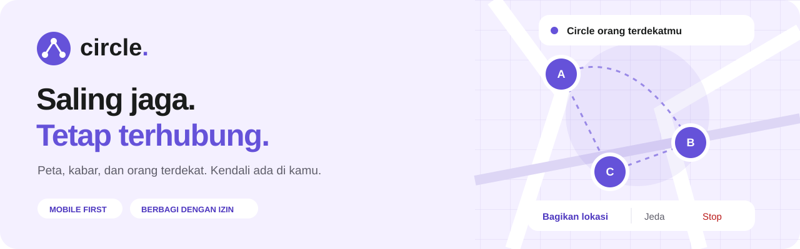
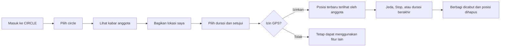
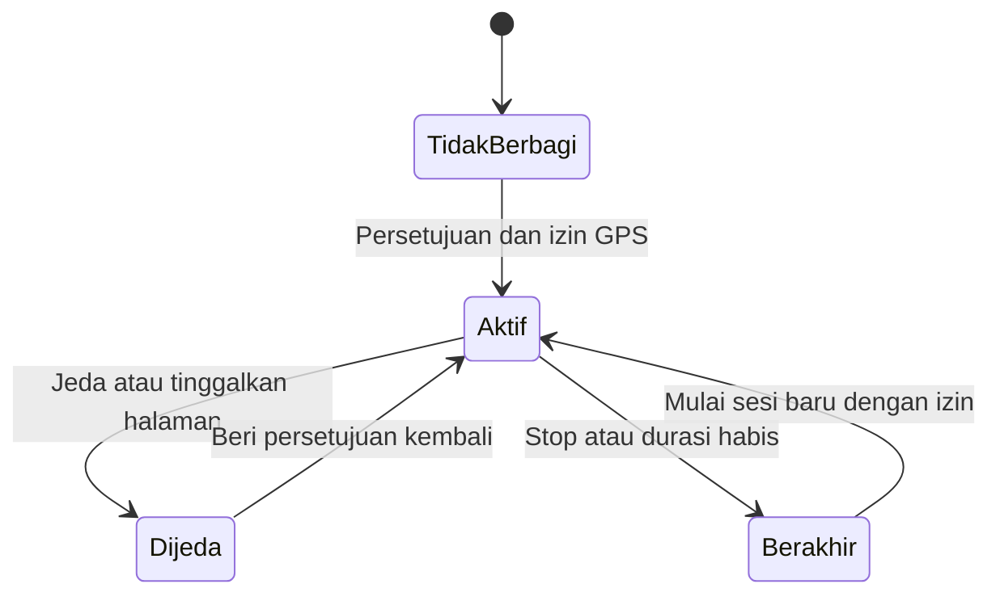
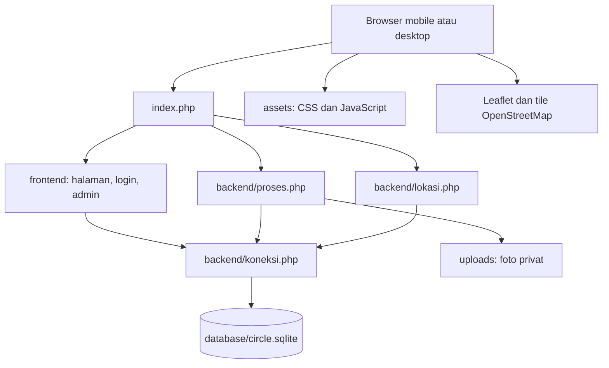
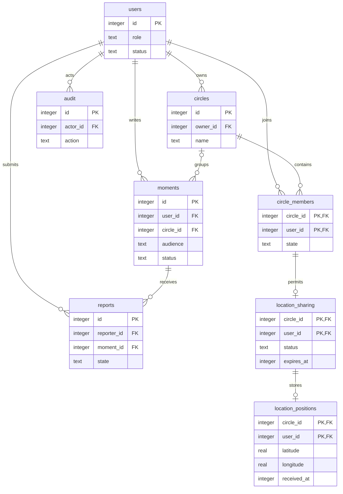

<p align="center">
  
</p>

<p align="center">
  <strong>Berbagi kabar. Melihat posisi. Tetap memegang kendali.</strong><br>
  Web untuk saling menjaga di dalam circle orang terdekat.
</p>

<p align="center">
  <a href="#mengenal-circle">Tentang</a> ·
  <a href="#mulai-di-komputer-sendiri">Jalankan</a> ·
  <a href="#peta-folder-proyek">Folder</a> ·
  <a href="#alur-sistem">Arsitektur</a> ·
  <a href="#relasi-database">Database</a>
</p>

---

## Mengenal CIRCLE

Teman kuliah pulang melalui rute berbeda, keluarga ingin saling memberi kabar, atau anggota kelompok ingin tetap terhubung setelah kegiatan. CIRCLE menyediakan ruang bersama untuk melihat lokasi yang **secara sukarela dibagikan** dan membaca momen dari orang yang dipercaya.

Peta menjadi layar utama di mobile. Pemilih circle, daftar anggota, dan navbar berada di atas peta sehingga pengguna dapat berpindah konteks tanpa kehilangan orientasi. Admin mempunyai ruang desktop untuk menangani laporan dan status akun.

> **Kendali ada pada pemilik lokasi.** Bergabung ke circle tidak otomatis menyalakan GPS. Pin tempat posting momen juga tidak membuka posisi perangkat pengguna.

| Peta anggota | Momen | Circle | Pengelolaan |
| :--- | :--- | :--- | :--- |
| Lokasi terbaru, akurasi, dan waktu pembaruan | Foto atau ilustrasi dengan audiens pilihan | Undangan dan keanggotaan yang harus diterima | Laporan, pembatasan akun, serta catatan keputusan |

## Siapa bisa melakukan apa?

| Kemampuan | Guest | User | Admin |
| :--- | :---: | :---: | :---: |
| Membuka peta momen publik | ✓ | ✓ | ✓ |
| Mengelola profil dan momen sendiri | — | ✓ | ✓ |
| Membuat circle | — | ✓ | ✓ |
| Menerima undangan sebagai anggota | — | ✓ | Tujuan undangan adalah akun user |
| Membaca lokasi anggota | — | Wajib anggota dan izin aktif | Tetap wajib anggota dan izin aktif |
| Meninjau laporan dan mengelola status akun | — | — | ✓ |

Admin memperoleh konteks momen yang dilaporkan. Perannya tidak memberikan akses bebas ke semua foto privat maupun lokasi perangkat.

## Perjalanan pengguna



### Dua mode peta, dua arti pin

| Mode Anggota | Mode Momen |
| :--- | :--- |
| Posisi perangkat yang diizinkan oleh pemiliknya | Tempat posting yang ditambahkan pada cerita |
| Memuat akurasi dan waktu pembaruan | Memuat penulis, caption, dan audiens |
| Berubah selama sesi berbagi berjalan | Tetap melekat pada momen |
| Posisi lama disembunyikan setelah 2 menit | Tidak menunjukkan pergerakan seseorang |

### Kontrol berbagi lokasi



- **Durasi:** 15 menit, 1 jam, atau 4 jam; pilihan awal 1 jam.
- **Pembaruan:** sekitar setiap 15 detik ketika halaman Peta aktif.
- **Kedaluwarsa:** posisi lebih lama dari 2 menit tidak ditampilkan; akurasi di atas 100 meter ditandai *Perkiraan*.
- **Jeda/Stop:** pembacaan GPS berhenti. Jika jaringan putus, aplikasi menandai penghapusan server belum terkonfirmasi; titik lama tetap dibatasi masa berlakunya.
- **Pindah circle:** sesi lama dijeda. Circle baru memerlukan persetujuan berbagi yang baru.

## Mulai di komputer sendiri

### Kebutuhan

| Komponen | Keterangan |
| :--- | :--- |
| PHP | 8.3+; diuji dengan 8.5.12 |
| Ekstensi | PDO SQLite, mbstring, fileinfo, dan GD |
| Browser | Browser modern dengan JavaScript dan Geolocation |
| Internet | Untuk Leaflet dan tile OpenStreetMap |

**Windows dengan XAMPP:** klik dua kali `MULAI.cmd`, lalu buka **http://127.0.0.1:8788**. Launcher mengharapkan PHP di `C:\xampp\php\php.exe`. Biarkan layanan tetap berjalan selama aplikasi digunakan.

**Melalui terminal**, jalankan dari folder proyek:

```sh
php -d extension=gd -S 127.0.0.1:8788 -t . index.php
```

Tidak memerlukan Composer, npm, proses build, atau pembuatan database manual. Saat pertama dibuka, aplikasi membuat tabel dari `database/skema.sql`, kemudian menambahkan data contoh lokal. Database pribadi tidak disertakan di GitHub.

> Untuk GPS di ponsel, gunakan alamat HTTPS yang sesuai. Membuka alamat HTTP laptop dari perangkat lain tidak cukup untuk pengujian izin lokasi. `localhost` pada ponsel juga merujuk ke ponsel itu sendiri.

## Peta folder proyek

```text
circle - simple/
│
├── frontend/                 Tampilan halaman
│   ├── halaman.php           Peta, Momen, Circle, dan Akun
│   ├── login.php             Masuk dan daftar
│   └── admin.php             Dashboard dan pengelolaan
│
├── backend/                  Aturan dan proses aplikasi
│   ├── koneksi.php           Koneksi SQLite, sesi, dan fungsi bersama
│   ├── proses.php            Formulir, foto, undangan, dan moderasi
│   └── lokasi.php            API posisi dan izin berbagi
│
├── assets/                   CSS, JavaScript, dan ilustrasi README
├── database/
│   ├── skema.sql             Struktur tabel yang masuk repository
│   └── circle.sqlite         Data lokal; diabaikan Git
├── uploads/                  Foto privat; diabaikan Git
│
├── index.php                 Pintu masuk dan pengarah permintaan
├── MULAI.cmd                 Launcher Windows
├── README.md                 Gambaran dan panduan pengembang
└── README.txt                Petunjuk penggunaan lebih lengkap
```

<details>
<summary><strong>Mulai membaca kode dari mana?</strong></summary>

1. Buka [`index.php`](index.php) untuk melihat tujuan setiap URL.
2. Buka [`frontend/halaman.php`](frontend/halaman.php) untuk mengikuti tampilan pengguna.
3. Ikuti formulir ke [`backend/proses.php`](backend/proses.php), lalu lihat aturan penyimpanan di [`backend/koneksi.php`](backend/koneksi.php).
4. Untuk peta dan GPS, baca [`assets/script.js`](assets/script.js) bersama [`backend/lokasi.php`](backend/lokasi.php).
5. Buka [`database/skema.sql`](database/skema.sql) untuk mempelajari relasi data.

</details>

## Alur sistem



| URL yang dibuka browser | Berkas yang menjalankan proses |
| :--- | :--- |
| `/` atau `index.php` | `frontend/halaman.php` |
| `login.php` | `frontend/login.php` |
| `admin.php` | `frontend/admin.php` |
| `backend.php` | `backend/proses.php` |
| `lokasi.php` | `backend/lokasi.php` |

Nama URL sengaja tetap singkat. `index.php` meneruskannya ke file dalam folder yang sesuai; tidak ada salinan file halaman di depan. File internal dan unggahan privat tidak dibuka langsung melalui alamat foldernya.

## Relasi database

Diagram berikut mengikuti **SQLite yang digunakan aplikasi saat ini**.



`PK` adalah kunci utama dan `FK` adalah kunci relasi. Pada tabel keanggotaan serta lokasi, pasangan `circle_id + user_id` menjadi kunci gabungan. Diagram menampilkan kolom inti; definisi lengkap ada di [`skema.sql`](database/skema.sql).

Satu izin berbagi menyimpan **maksimal satu posisi terbaru**, bukan riwayat perjalanan. Momen ber-audiens Circle memiliki circle tujuan; momen Publik atau Hanya saya tidak memerlukannya.

## Privasi dan batas akses

| Bagian | Perilaku aplikasi |
| :--- | :--- |
| Identitas | Sandi disimpan sebagai hash; sesi memakai cookie HttpOnly dan SameSite=Lax, serta Secure pada HTTPS |
| Hak akses | Diperiksa kembali di PHP; role dari formulir tidak dapat menaikkan akun menjadi admin |
| Formulir | Validasi server, CSRF, escaping HTML, dan pencegahan pemrosesan ulang ID formulir dalam sesi |
| Lokasi | Pembaca dan pengirim wajib anggota yang diterima; durasi serta kesegaran posisi diperiksa server |
| Foto | Maksimal 5 MB dan sisi 6000 px; foto baru dikodekan ulang ke WebP maksimal 1800 px untuk membuang metadata |
| Moderasi | Keputusan dan alasan disimpan bersama; pembatasan akun mencabut akses dan berbagi lokasi |
| Repository | `.env`, database lokal, dan foto unggahan dikecualikan melalui `.gitignore` |

<details>
<summary><strong>Kenapa ada file .htaccess di beberapa folder?</strong></summary>

`.htaccess` adalah file aturan untuk **server Apache**, bukan halaman aplikasi.

- File di folder utama mengarahkan URL ke `index.php` dan menolak akses langsung ke folder internal.
- File di `database`, `uploads`, `backend`, dan `frontend` berisi `Require all denied`: lapisan tambahan yang menolak pembukaan file folder tersebut melalui HTTP.
- PHP tetap boleh membaca file itu dari dalam program setelah menjalankan pemeriksaan izin.
- Saat memakai `MULAI.cmd`, server bawaan PHP tidak menggunakan `.htaccess`. Perlindungan akses dijalankan melalui daftar URL yang diizinkan pada `index.php`.

GitHub menampilkannya karena file aturan tersebut ikut disimpan sebagai bagian dari proyek. File-file ini sengaja dipertahankan agar perlindungan tetap tersedia jika aplikasi dipindahkan ke Apache. Apache memerlukan `mod_rewrite`, GD, serta penerapan aturan `.htaccess` yang benar.

</details>

## Catatan implementasi

| Sudah digunakan | Belum dipasang atau belum diverifikasi |
| :--- | :--- |
| PHP native, SQLite, sesi PHP, dan unggahan lokal | Supabase Auth, PostgreSQL, dan Storage |
| UI mobile serta dashboard admin desktop | Deployment hosted dan CI otomatis |
| Pengujian GPS dengan lokasi simulasi | Pengujian GPS pada ponsel fisik |

Dokumen topik tugas mensyaratkan **Laravel**. Repository ini memuat implementasi PHP sederhana untuk pengembangan dan demonstrasi lokal; migrasi ke Laravel/Supabase perlu dikerjakan sesuai kebutuhan pengumpulan.

CIRCLE tidak menjanjikan pelacakan di latar belakang, tidak menyimpan riwayat perjalanan, dan belum menyediakan pengiriman SOS. Posisi di peta tidak membuktikan seseorang aman dan tidak menggantikan layanan darurat.

## Verifikasi dan perawatan

Alur login, hak akses antarperan, undangan, momen privat, moderasi, Jeda/Stop lokasi, unggahan foto, serta tampilan mobile/desktop telah diuji pada salinan data terpisah. Pengujian tersebut dilakukan sebelum unggahan; repository belum mempunyai workflow pengujian otomatis.

Untuk cadangan, hentikan layanan lalu salin folder **database** dan **uploads** ke tempat aman. Jangan menghapus `circle.sqlite` untuk merapikan proyek karena berkas itu menyimpan akun dan konten. Petunjuk operasional lebih lengkap ada di [README.txt](README.txt).

---

<p align="center"><strong>CIRCLE</strong> · Kelompok 8 · Web Programming<br><sub>Saling jaga dengan persetujuan, keterbukaan, dan kendali masing-masing.</sub></p>
